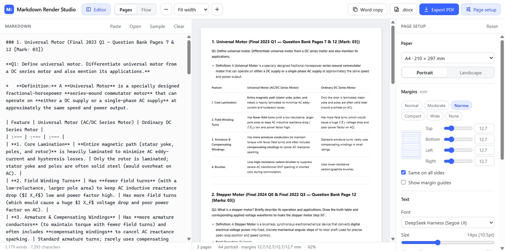

# Markdown Render Studio

**Paste raw Markdown from an AI chat and get a clean, faithful render, a paginated PDF, a one-click Word copy and a native `.docx`.**

### ▶ Live app: **https://likhonmain.github.io/markdown-render-studio/**



AI tools such as Google AI Studio, ChatGPT and DeepSeek answer in Markdown with **bold**, nested lists, wide tables and LaTeX equations. Copying that raw text anywhere else usually breaks it. Markdown Render Studio renders it the way the chat UI showed it, then lets you print or export it without losing any formatting.

The renderer copies the DeepSeek Harness chat renderer: the same Markdown parser, KaTeX 0.16 math, typography and table styling. AI answers therefore look the same as they do there.

---

## Features

### Faithful rendering
- GitHub-Flavoured Markdown: headings, **bold**/*italic*/~~strike~~, nested bullet and numbered lists, task lists, tables with column alignment, code blocks, block quotes, links, footnotes.
- **LaTeX math** with KaTeX, using every delimiter AI models produce:
  `$inline$`, `$$display$$` (also on a single line, even inside list items), `\(inline\)` and `\[display\]`.
- If an equation has a TeX error, it still renders leniently instead of breaking the page.

### Live page preview and PDF export
- **Pages view** shows exactly what the PDF will contain, updating as you type.
- Real pagination: text flows to the next page **line by line**, lists continue across pages, long tables split between rows and **repeat their header row** on every page. Headings and bold lead-in lines (e.g. `**Applications:**`) are never left stranded at the bottom of a page.
- **Export PDF** opens the browser's print dialog with pages already set up at the right size (choose *Save as PDF*).
- Force a new page with a line containing `\newpage` or `<!-- pagebreak -->`.

### Page setup (all live, nothing hidden)
- Paper: A4, Letter, Legal, A5, A3 or a custom size; portrait or landscape.
- **Margins**: presets (Normal, Moderate, Narrow, Compact, Wide, None) or per-side sliders, with optional margin guides.
- Font family, font size and line spacing.
- Table style: *Minimal* (DeepSeek Harness look) or *Grid* (Word look).
- Page numbers on/off.

### Content always fits
- **Wide tables** shrink to fit the page or window, keeping words whole, instead of overflowing or scrolling.
- **Long equations** scale down to fit the column.

### Zoom and views
- *Fit width*, *Fit page*, 50 – 200 %, <kbd>Ctrl</kbd> + mouse wheel, <kbd>Ctrl</kbd> <kbd>+</kbd>/<kbd>−</kbd>/<kbd>0</kbd>.
- **Flow view**: a continuous reading view that reflows to the window width.
- Resizable editor pane; editor and setup panels can be hidden for a full-width preview.

### Word
- **Word copy** puts the whole document on the clipboard in a format Word understands. Paste with <kbd>Ctrl</kbd>+<kbd>V</kbd> and you get bold text, lists, real Word tables and **native, editable Word equations**. Tested with Microsoft Word on Windows from Chrome.
- **.docx** downloads a native Word document: real lists, tables sized to the page, editable equations, page numbers, and the same paper size and margins as the preview.

### Private by design
Everything runs in your browser. Your text is never uploaded anywhere; it is only kept in the browser's local storage so it survives a refresh.

---

## How to use

1. Open the [live app](https://likhonmain.github.io/markdown-render-studio/).
2. In your AI chat, copy the **raw Markdown** of the answer (most chat UIs have a *Copy* or *Copy as Markdown* button).
3. Paste it into the editor on the left (or click **Paste**). You can also open or drag in a `.md` / `.txt` file.
4. Adjust paper, margins and font in **Page setup** while watching the preview.
5. Click **Export PDF**, **Word copy** or **.docx**.

**Getting the best PDF:** in the print dialog choose *Save as PDF*, set *Margins* to *Default* or *None* (the page margins are already built in), and under *More settings* tick **Background graphics** so table shading prints.

| Shortcut | Action |
| --- | --- |
| <kbd>Ctrl</kbd>+<kbd>P</kbd> | Export PDF |
| <kbd>Ctrl</kbd>+<kbd>E</kbd> | Show / hide the editor |
| <kbd>Ctrl</kbd>+<kbd>+</kbd> / <kbd>Ctrl</kbd>+<kbd>−</kbd> | Zoom in / out |
| <kbd>Ctrl</kbd>+<kbd>0</kbd> | Fit width |
| <kbd>Ctrl</kbd> + mouse wheel | Zoom around the cursor |

---

## Run locally

Requires [Node.js](https://nodejs.org/) 20 or newer.

```bash
git clone https://github.com/likhonmain/markdown-render-studio.git
cd markdown-render-studio
npm install
npm run dev        # http://localhost:5178
```

| Script | Purpose |
| --- | --- |
| `npm run dev` | Development server with hot reload |
| `npm run build` | Type-check and build the static site into `dist/` |
| `npm run preview` | Serve the built `dist/` locally |
| `npm run deploy` | Build and publish `dist/` to the `gh-pages` branch (GitHub Pages) |

## Deployment

The build is a plain static site and asset paths are relative (`base: './'`), so `dist/` works from any host or sub-path.

- **GitHub Pages** (this repo): run `npm run deploy`. Pages serves the `gh-pages` branch.
- **Cloudflare Pages**: connect the repo with build command `npm run build` and output directory `dist`, or drag the `dist/` folder into *Workers & Pages → Upload assets*.
- **Netlify / Vercel / any static host**: same build command and output directory.

## Project structure

```
index.html            App shell (toolbar, editor, preview, page setup)
src/
  main.ts             UI controller: rendering, zoom, auto-fit, print, exports
  markdown.ts         Markdown → HTML (GFM, math-delimiter normalisation, KaTeX)
  paginate.ts         Paginator: splits content between lines, list items and table rows
  wordcopy.ts         Word-ready clipboard HTML (MathML equations, inline styles)
  docx.ts             Native .docx writer (lists, tables, styles, page setup)
  omml.ts             MathML → Office Math (OMML) converter for Word equations
  settings.ts         Paper sizes, margin presets, fonts, persisted settings
  sample.md           Built-in sample document
  styles/
    markdown.css      DeepSeek-Harness-style typography
    app.css           Application UI
    print.css         Print / PDF rules
```

**Tech:** TypeScript, [Vite](https://vite.dev/), [unified](https://unifiedjs.com/) / remark (micromark, GFM, math), [KaTeX](https://katex.org/), [JSZip](https://stuk.github.io/jszip/). No UI framework.

## Browser support

Latest Chrome, Edge and Firefox; Safari 16.4+. Word copy works best from Chromium-based browsers.

## License

[MIT](LICENSE) © Tanvir Ahamed Likhon

## Mobile status (to check)

The phone layout (bottom tabs: Edit / Preview / Setup / Export) was tested only in a Chrome iPhone emulator, not on a real phone. Still to check:

- On a real Android/iPhone: the keyboard hiding the tab bar while typing, and pinch-to-zoom on the preview.
- Export PDF from a phone browser (mobile print dialogs vary), the .docx download, and Word copy (clipboard).
- Landscape orientation on phones and tablet sizes (switch point is 820px).
